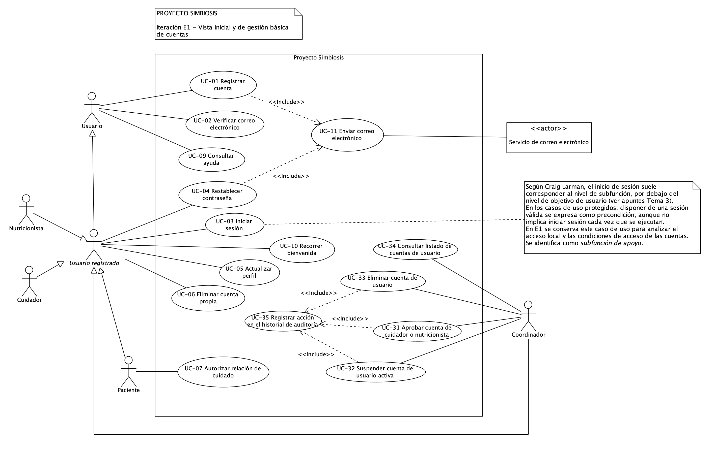
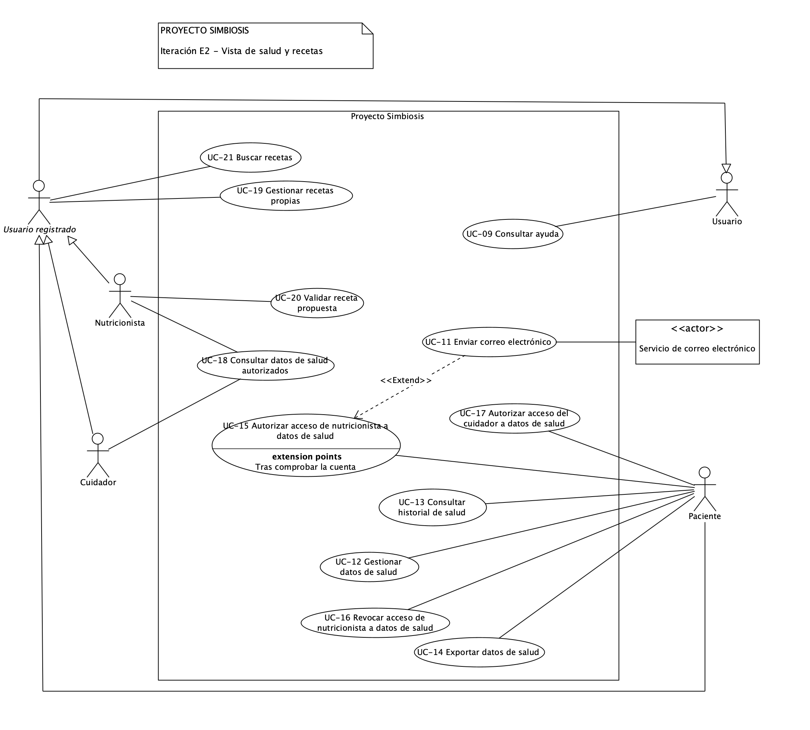

# Modelo de casos de uso de Proyecto Simbiosis

| Versión | Fecha | Estado |
| --- | --- | --- |
| 1.7 | 13/10/2026 | Borrador |

**Iteraciones de referencia:** E1 y E2. Este documento recoge la primera vista revisada del modelo (E1) y la segunda vista, de salud y recetas (E2). Será el punto de partida para ampliarlo en iteraciones posteriores.

**Plantilla base:** [Plantilla del modelo de casos de uso](plantilla-modelo-casos-de-uso.md). La plantilla se conserva sin cumplimentar. Los resultados del proyecto se incorporan a este documento.

Los diagramas representan distintas vistas del mismo modelo. Los nombres de los actores y los identificadores de los casos de uso se mantienen entre iteraciones.

## 1 Alcance del modelo

### 1.1 Vista de E1

La vista de E1 representa el acceso local, la gestión básica de cuentas y la ayuda seleccionada en el apartado 4 del [plan de E1](../planificacion/plan-iteracion-e1.md). Cubre parte de UR-01, UR-02, UR-03, UR-12 y UR-13.

Incluye el registro local y sus condiciones por perfil, la verificación del correo, el inicio de sesión y el restablecimiento de la contraseña. Incluye también la actualización del perfil, la eliminación de la cuenta propia, la autorización de una relación de cuidado, la gestión básica de cuentas por el coordinador, la ayuda contextual y la bienvenida.

La gestión básica de cuentas se representa mediante cuatro objetivos del coordinador: aprobar cuentas de cuidador y nutricionista, suspender cuentas, eliminar cuentas y consultar el listado de cuentas. Las operaciones de aprobación, suspensión y eliminación incluyen el registro de la acción en el historial de auditoría.

La verificación del correo, la aprobación de una cuenta por el coordinador y la autorización de una relación de cuidado son condiciones distintas. Verificar el correo no sustituye las otras dos condiciones.

### 1.2 Vista de E2

La vista de E2 representa las funciones de salud y recetas seleccionadas en los apartados 4.1 a 4.5 del [plan de E2](../planificacion/plan-iteracion-e2.md). Cubre parte de UR-05, UR-06 y UR-08, y reutiliza elementos de UR-12 y UR-01.

Incluye el registro y la corrección de datos de salud, la consulta del historial y su exportación, la autorización y la revocación del acceso de nutricionistas y cuidadores, la invitación a un nutricionista sin cuenta y la consulta de datos de un paciente por un participante autorizado. Incluye también la creación y la validación de recetas, la gestión de las recetas propias, la búsqueda y consulta de recetas y el filtrado por alergias e intolerancias.

Son condiciones distintas, y el modelo las mantiene separadas: la verificación del correo, la aprobación profesional, la aceptación de una relación de cuidado, la autorización de acceso a datos y la validación de una receta. Una relación de cuidado activa no concede acceso automático a los datos del paciente. Recibir una invitación no concede acceso a datos de salud.

### 1.3 Pendiente del modelo

El modelo no completa los módulos de Gestión de usuarios, Guía interactiva, Salud ni Recetas. Quedan pendientes las siguientes funciones:

- El registro, el acceso y la vinculación con Google (FR-006, FR-018, FR-190).
- La ayuda sobre las funciones todavía no representadas, el progreso entre sesiones, la multimedia y la búsqueda de temas.
- El bloqueo temporal y la expulsión por infracciones (FR-186, FR-187).
- El fin de las relaciones de cuidado y la gestión automática de cuentas de cuidador sin pacientes (FR-209, FR-210).
- Los recordatorios de salud y la propuesta profesional de su frecuencia (FR-043, FR-044, FR-199, FR-200).
- Las alertas críticas y la gestión de umbrales (FR-051, FR-052, FR-202, FR-203, FR-217).
- La calculadora nutricional y las estadísticas de recetas (FR-064, FR-065).
- La ordenación por popularidad o calificación, las sugerencias y las recomendaciones (FR-097, FR-098, FR-100 a FR-102, FR-104 a FR-108).
- Las notificaciones de nuevas recetas, el historial de búsqueda, las favoritas, las listas, la descarga, la impresión y la compartición de recetas (FR-109 a FR-118).
- El foro, los consejos de vida saludable, los reportes, la moderación, las valoraciones y los comentarios (UR-04, UR-07, UR-09, UR-10 y UR-11).

Los aplazamientos conservan los requisitos del proyecto. El modelo recoge las funciones seleccionadas para el trabajo de requisitos de cada iteración, aunque algunas queden fuera de su prototipo.

## 2 Actores

Un actor representa un rol externo que interactúa con Proyecto Simbiosis. Una misma persona puede desempeñar más de un rol.

| Nombre del actor | Rol que representa |
| --- | --- |
| Usuario | Persona que interactúa con la plataforma. Este rol general permite representar funciones que no exigen una sesión iniciada. |
| Usuario registrado | Persona que tiene una cuenta. La existencia de la cuenta no implica que haya iniciado sesión. |
| Paciente | Usuario registrado que puede autorizar una relación de cuidado solicitada para él, gestionar sus datos de salud y decidir quién puede consultarlos. |
| Cuidador | Usuario registrado que solicita o mantiene relaciones de cuidado con pacientes. Puede consultar los datos de salud que el paciente decida compartir. |
| Nutricionista | Usuario registrado con perfil profesional sujeto a la aprobación de su documentación. Puede consultar los datos de los pacientes que lo autorizan y validar recetas. |
| Coordinador | Usuario registrado que consulta el listado de cuentas y aprueba, suspende o elimina cuentas dentro de sus permisos. |
| Servicio de correo electrónico | Sistema externo que presta el servicio de envío de mensajes de verificación, restablecimiento e invitación. |

**Generalizaciones.** Usuario registrado especializa a Usuario. Paciente, Cuidador, Nutricionista y Coordinador especializan a Usuario registrado. Cada actor especializado hereda la participación del actor general en sus casos de uso.

Usuario registrado se representa como actor abstracto para agrupar las funciones comunes de los perfiles. La generalización expresa roles, no una secuencia de registro o de inicio de sesión. Paciente y Cuidador no son roles excluyentes: FR-212 permite que una cuenta tenga ambos perfiles.

En la vista de E1, Cuidador y Nutricionista no tienen asociaciones exclusivas y participan mediante las funciones heredadas. En la vista de E2 se asocian directamente a los casos de uso de recetas y de consulta de datos de salud.

Las funciones de recetas y de búsqueda se asocian a Paciente, Cuidador y Nutricionista, y no a Usuario registrado, porque Coordinador también especializa a Usuario registrado y no participa en esas funciones en E2. Así se aplica la exigencia de registro de FR-119.

El Servicio de correo electrónico es un actor de apoyo y no pertenece a la jerarquía de usuarios. En E2 se reutiliza sin cambiar su nombre.

El registro de auditoría forma parte del comportamiento del sistema. No requiere un actor adicional ni una interacción directa del Coordinador con UC-35.

## 3 Casos de uso

Los objetivos de esta tabla son resúmenes. Las descripciones detalladas quedan pendientes en el apartado 6. Los casos UC-12 a UC-23 son los incorporados por E2.

| Identificador | Nombre | Objetivo | Participantes |
| --- | --- | --- | --- |
| UC-01 | Registrar cuenta | Solicitar una cuenta local con los datos y las condiciones del perfil elegido. | Principal: Usuario. Apoyo: Servicio de correo electrónico, mediante UC-11. |
| UC-02 | Verificar correo electrónico | Confirmar la dirección de correo como condición para completar el registro. | Principal: Usuario. |
| UC-03 | Iniciar sesión | Establecer una sesión mediante las credenciales de una cuenta cuyo estado permita el acceso. | Principal: Usuario registrado. |
| UC-04 | Restablecer contraseña | Recuperar el acceso mediante un enlace enviado al correo de la cuenta. | Principal: Usuario registrado. Apoyo: Servicio de correo electrónico, mediante UC-11. |
| UC-05 | Actualizar perfil | Modificar los datos personales y las preferencias de la cuenta propia. | Principal: Usuario registrado. |
| UC-06 | Eliminar cuenta propia | Eliminar la cuenta propia tras comprobar la identidad con la contraseña actual. | Principal: Usuario registrado. |
| UC-07 | Autorizar relación de cuidado | Dar autorización expresa para activar una relación de cuidado concreta. | Principal: Paciente. |
| UC-09 | Consultar ayuda | Consultar las instrucciones y los temas de ayuda de las funciones seleccionadas. | Principal: Usuario. |
| UC-10 | Recorrer bienvenida | Conocer las funciones básicas mediante el recorrido del primer acceso, con la posibilidad de omitirlo. | Principal: Usuario registrado. |
| UC-11 | Enviar correo electrónico | Enviar el mensaje que necesita el caso de uso que lo incluye. | Apoyo: Servicio de correo electrónico. No se asigna un actor principal independiente. |
| UC-12 | Registrar datos de salud | Introducir y corregir datos fisiológicos, resultados de laboratorio y notas de síntomas o estado de salud. | Principal: Paciente. |
| UC-13 | Consultar historial de salud | Consultar el historial de datos propios, filtrarlo por tipo de dato y verlo en gráficas. | Principal: Paciente. |
| UC-14 | Exportar datos de salud | Obtener los datos fisiológicos y de salud propios en formato PDF o CSV. | Principal: Paciente. |
| UC-15 | Autorizar acceso a datos de salud | Autorizar a un nutricionista concreto, o a un cuidador, a consultar los datos de salud que el paciente decida compartir. | Principal: Paciente. |
| UC-16 | Invitar a nutricionista sin cuenta | Invitar por correo a registrarse a un nutricionista que no tiene cuenta, sin concederle acceso a los datos. | Principal: Paciente. Apoyo: Servicio de correo electrónico, mediante UC-11. |
| UC-17 | Revocar acceso de nutricionista | Retirar en cualquier momento el acceso concedido a un nutricionista. | Principal: Paciente. |
| UC-18 | Consultar datos de salud de un paciente | Consultar los datos de salud de un paciente dentro de los límites de su autorización. | Principal: Nutricionista, Cuidador. |
| UC-19 | Crear receta | Crear una receta con los datos obligatorios, el contenido multimedia admitido, categorías y etiquetas. La receta se publica como validada o queda pendiente de validación según su autor. | Principal: Paciente, Cuidador, Nutricionista. |
| UC-20 | Validar receta propuesta | Revisar una receta propuesta por un paciente o un cuidador y publicarla como validada. | Principal: Nutricionista. |
| UC-21 | Gestionar recetas propias | Editar una receta propia conservando el registro de ediciones, eliminarla tras una confirmación previa y consultar el historial de recetas propias. | Principal: Paciente, Cuidador, Nutricionista. |
| UC-22 | Buscar y consultar recetas | Encontrar recetas por palabras clave, ingredientes, autor y filtros combinados, ordenar los resultados y consultar el detalle de una receta. | Principal: Paciente, Cuidador, Nutricionista. |
| UC-23 | Filtrar por alergias e intolerancias | Excluir de los resultados las recetas incompatibles con las alergias e intolerancias del perfil. | Principal: Paciente, Cuidador, Nutricionista, a través de UC-22. |
| UC-31 | Aprobar cuenta de cuidador o nutricionista | Aprobar una cuenta solicitada con perfil de cuidador o nutricionista, conforme a las condiciones del perfil. | Principal: Coordinador. |
| UC-32 | Suspender cuenta de usuario activa | Suspender una cuenta de usuario que se encuentra activa. | Principal: Coordinador. |
| UC-33 | Eliminar cuenta de usuario | Eliminar una cuenta de usuario y conservar el contenido publicado cuando corresponda a un cuidador. | Principal: Coordinador. |
| UC-34 | Consultar listado de cuentas de usuario | Consultar las cuentas y su información básica: nombre, correo, rol y estado. | Principal: Coordinador. |
| UC-35 | Registrar acción en el historial de auditoría | Registrar la fecha, la hora y la acción realizada al aprobar, suspender o eliminar una cuenta. | Sin participación directa de un actor. Comportamiento incluido en UC-31, UC-32 y UC-33. |

### 3.1 Casos de E1

UC-03 se representa como una subfunción de apoyo. Tener una sesión válida es una condición previa de las funciones protegidas. Esto no implica ejecutar UC-03 cada vez que se realiza una de ellas.

UC-04 requiere una cuenta, pero no una sesión iniciada. UC-02 representa la acción de verificar el correo; recibir el mensaje de UC-11 no equivale a verificarlo.

UC-07 se aplica a cada relación de cuidado. Su objetivo se distingue de la aprobación de la cuenta de cuidador que realiza el Coordinador en UC-31.

UC-31 representa la aprobación de la cuenta por el Coordinador. Esta aprobación no sustituye la verificación del correo ni la autorización de cada paciente para activar una relación de cuidado.

UC-32 representa la suspensión administrativa seleccionada para E1. No incorpora el bloqueo temporal ni la expulsión por infracciones, que siguen pendientes.

UC-33 se distingue de UC-06 Eliminar cuenta propia. En UC-33, el Coordinador actúa sobre una cuenta de usuario. En UC-06, el titular actúa sobre su propia cuenta.

UC-35 es una subfunción compartida. No representa una operación que el Coordinador inicie por separado.

### 3.2 Casos de E2

UC-12 agrupa el registro y la corrección de datos de salud porque ambas acciones persiguen el mismo objetivo: mantener los datos propios al día y sin errores.

UC-13 incluye el filtro por tipo de dato (FR-216) y las gráficas (FR-050) como variantes del mismo objetivo de consulta. No tienen caso propio.

UC-15 cubre la autorización a nutricionistas y a cuidadores, porque el objetivo es el mismo y solo cambia el destinatario. UC-15 es distinto de UC-07: UC-07 autoriza una relación de cuidado, mientras que UC-15 autoriza el acceso a datos de salud. Una relación de cuidado activa no concede acceso a los datos.

UC-16 solo ocurre cuando el nutricionista indicado no tiene cuenta. Recibir la invitación no concede acceso. El nutricionista debe verificar su correo, completar la verificación profesional y contar con la autorización del paciente.

UC-17 se limita a nutricionistas porque FR-198 no menciona a los cuidadores. Si debe cubrir también la revocación a cuidadores es una pregunta abierta.

UC-18 es un caso de consulta. Ningún FR lo describe como tal, y se deriva de FR-045 y FR-201. La comprobación de la autorización es una regla del servidor, no un objetivo del actor. Para el Cuidador, la relación de cuidado activa (UC-07) es una condición previa, y FR-208 retira el acceso cuando termina la asociación.

UC-19 recoge la creación de la receta. Si la propone un paciente o un cuidador, queda pendiente de validación (FR-204). Si la crea un nutricionista aprobado, se publica como validada (FR-055). Mientras su documentación no esté aprobada, el nutricionista tiene las funciones de un usuario general (FR-191).

UC-20 tiene como condición previa un nutricionista aprobado (UC-31) y una receta pendiente de validación. Tras la validación, la receta se publica con la insignia correspondiente (FR-066).

UC-21 agrupa tres acciones sobre las recetas propias: editar, eliminar y consultar el historial. La confirmación previa a la eliminación es un paso interno.

UC-22 termina de forma natural en el detalle de la receta, por lo que ambas acciones se agrupan. Las funciones de búsqueda avanzada y los resultados personalizados exigen registro e inicio de sesión (FR-119).

UC-23 solo se activa cuando el usuario filtra por las alergias e intolerancias de su perfil. El filtrado no demuestra que una receta sea clínicamente segura. El sistema no modifica ingredientes ni cantidades ni realiza recomendaciones médicas.

**Reglas sin caso propio.** El alias como identidad pública (FR-192), la insignia de receta validada (FR-066) y los nuevos temas de ayuda sobre búsqueda y publicación de recetas (parte de FR-173) se aplican sobre los casos existentes. UC-09 se mantiene y no se crea un caso nuevo por tener más temas.

## 4 Diagramas del modelo

### 4.1 Vista de acceso, cuentas y ayuda de E1

**Frontera del sistema:** Proyecto Simbiosis.

**Alcance:** Registro y acceso local, condiciones por perfil, gestión básica de cuentas, ayuda contextual y bienvenida. La vista contiene siete actores y los quince casos de uso de E1: UC-01 a UC-07, UC-09 a UC-11 y UC-31 a UC-35.

**Relaciones entre casos de uso.** UC-01 y UC-04 incluyen UC-11. Ambos necesitan enviar un correo para completar el comportamiento previsto. Las flechas de inclusión apuntan desde cada caso base hacia UC-11. La participación del Servicio de correo electrónico se representa mediante su asociación con UC-11.

UC-31, UC-32 y UC-33 incluyen UC-35. Las flechas de inclusión apuntan desde cada uno de esos casos hacia UC-35. Cuando se realiza una de esas acciones administrativas, el sistema registra la fecha, la hora y el tipo de acción.

UC-34 no incluye UC-35. FR-185 exige auditar las acciones de aprobación, suspensión y eliminación. No exige registrar la consulta del listado.

La vista no utiliza relaciones de extensión ni generalizaciones entre casos de uso. La bienvenida y la ayuda tienen objetivos propios y se representan por separado.

El inicio de sesión no se incluye en todos los casos protegidos. La comprobación de la contraseña actual al eliminar la cuenta tampoco implica un nuevo inicio de sesión.

La imagen se conserva en el repositorio con el nombre usado para esta referencia. Las revisiones de esta vista actualizarán el mismo archivo. Las nuevas vistas tendrán archivos distintos, de acuerdo con la [guía de modelos](README.md).

### 4.2 Vista de salud y recetas de E2

**Frontera del sistema:** Proyecto Simbiosis.

**Alcance:** Datos de salud e historial, acceso autorizado e invitación al nutricionista, creación y validación de recetas, búsqueda y consulta de recetas. La vista contiene seis actores y catorce casos de uso: los doce nuevos de E2 (UC-12 a UC-23) y dos de E1 que se reutilizan (UC-09 y UC-11).

**Elementos reutilizados de E1.** Los actores Usuario, Usuario registrado, Paciente, Cuidador, Nutricionista y Servicio de correo electrónico conservan su nombre y su jerarquía. UC-11 se reutiliza porque la invitación necesita enviar un correo. UC-09 se reutiliza porque E2 amplía sus temas de ayuda. Coordinador, UC-31 y las demás funciones de E1 no aparecen en esta vista, aunque UC-31 es condición previa de UC-19 y UC-20 para el nutricionista.

**Relaciones entre casos de uso.**

- **«include».** UC-16 incluye UC-11. Enviar la invitación es el mismo objetivo de envío de correo que reutilizan UC-01 y UC-04 en E1. El Servicio de correo electrónico participa mediante su asociación con UC-11. Es la única relación «include» de la vista.
- **«extend».** UC-16 extiende UC-15, porque la invitación solo ocurre si el correo indicado no tiene cuenta. UC-23 extiende UC-22, porque solo se activa si el usuario filtra por las alergias e intolerancias de su perfil. Las flechas apuntan desde el caso que extiende hacia el caso base.

**Relaciones descartadas.** No se representan como «include» las condiciones siguientes, porque son precondiciones o reglas del servidor y no objetivos del actor:

- Disponer de una sesión válida, coherente con la nota de la vista de E1 sobre UC-03.
- Comprobar la autorización en UC-18.
- Verificar la aprobación profesional en UC-20 y en la publicación directa de UC-19.
- Confirmar la eliminación de una receta en UC-21.
- Aplicar el filtro por tipo de dato o ver las gráficas en UC-13.

UC-07 y UC-15 tampoco se relacionan, porque autorizar una relación de cuidado y autorizar el acceso a datos son condiciones distintas.

La imagen se conserva con el nombre `casos-de-uso-salud-recetas-e2.png`, de acuerdo con la [guía de modelos](README.md). La vista pertenece al mismo modelo que la de E1 y usa la misma frontera del sistema y los mismos nombres de actores.

## 5 Respaldo en los requisitos

Los identificadores remiten al [catálogo canónico de requisitos](../requisitos/catalogo-requisitos.md), versión 1.13, y a la [SRS](../requisitos/srs.md), versión 0.14. UR identifica un requisito de usuario; FR, un requisito funcional; NFR, un requisito no funcional.

| Elemento del modelo | UR y FR de referencia | NFR pertinentes | Relación con los requisitos |
| --- | --- | --- | --- |
| UC-01 Registrar cuenta | UR-01; FR-001, FR-002, FR-003, FR-004, FR-005, FR-007, FR-008, FR-011, FR-012, FR-013, FR-014, FR-188, FR-189, FR-191, FR-193, FR-213, FR-214 y FR-215 | NFR-010 | Registro local, alias único, validaciones, CAPTCHA y aceptaciones independientes. La solicitud profesional incluye el PDF y sus límites; la solicitud de cuidador permite indicar pacientes. |
| UC-02 Verificar correo electrónico | UR-01; FR-003, FR-009, FR-010 y FR-214 | NFR-010 | Confirmación del correo, registro de fecha y hora en UTC y mensajes sobre el estado del registro. No sustituye la aprobación del perfil ni la autorización de cuidado. |
| UC-03 Iniciar sesión | UR-02; FR-015 | NFR-004, NFR-005 y NFR-010 | Acceso local con correo y contraseña. El rendimiento de este acceso se mide con la carga de NFR-004; su asociación con NFR-005 sigue pendiente en el catálogo. |
| UC-04 Restablecer contraseña | UR-02; FR-016 | NFR-010 | Restablecimiento mediante un enlace enviado al correo de la cuenta, sin exigir una sesión iniciada. |
| UC-05 Actualizar perfil | UR-03; FR-019 | NFR-010 | Edición de datos personales y preferencias. El alias y el correo no se pueden modificar. |
| UC-06 Eliminar cuenta propia | UR-03; FR-020; UR-13; FR-211 | NFR-010 | Comprobación de la contraseña actual. El contenido publicado por un cuidador se conserva tras eliminar su cuenta. |
| UC-07 Autorizar relación de cuidado | UR-01; FR-193 y FR-194 | NFR-010 | Cada paciente autoriza su relación antes de que se active. |
| UC-09 Consultar ayuda | UR-12; FR-172, parte de FR-173, FR-174, FR-175, FR-176 y FR-177 | NFR-010 | Ayuda sobre las funciones de E1 y, en E2, sobre la búsqueda y la publicación de recetas (parte de FR-173). Incluye navegación, elementos visuales, pausa, reanudación, cierre y adaptación a la sección. |
| UC-10 Recorrer bienvenida | UR-12; FR-207 | NFR-010 | Recorrido del primer acceso, que se puede omitir y es independiente de la ayuda contextual. |
| UC-11 Enviar correo electrónico y sus inclusiones | UR-01, UR-02 y UR-05; FR-003 y FR-016; invitación según el acta de UR-05 | — | Envío compartido de los mensajes de verificación, restablecimiento e invitación. El servicio externo participa en el envío. UC-16 lo incluye en E2. |
| UC-12 Registrar datos de salud | UR-05; FR-041, FR-042 y FR-053 | NFR-002 y NFR-010 | Introducción manual de datos fisiológicos, resultados de laboratorio con unidades y notas de hasta 500 caracteres. La corrección de datos se apoya en la aclaración de UR-05 (pendiente de contraste con el acta). NFR-002 exige copia diaria de la información de salud. |
| UC-13 Consultar historial de salud | UR-05; FR-049, FR-050 y FR-216 | NFR-010 | Historial ordenado de más reciente a más antiguo, gráficas accesibles y filtro por tipo de dato. El filtro y las gráficas son variantes de este caso. |
| UC-14 Exportar datos de salud | UR-05; FR-047 y FR-048 | NFR-010 | Exportación de los datos del paciente en PDF y en CSV. |
| UC-15 Autorizar acceso a datos de salud | UR-05; FR-045, FR-046 y FR-201 | NFR-010 | Autorización de nutricionistas específicos, con validación de su identidad, y de cuidadores para los datos que el paciente decida compartir. |
| UC-16 Invitar a nutricionista sin cuenta | UR-05; sin FR propio | NFR-010 | Invitación por correo a un nutricionista sin cuenta, según el apartado 2.6 del acta de UR-05 (pendiente de contraste). El plan de E2 no le asigna un FR. Recibir la invitación no concede acceso. |
| UC-17 Revocar acceso de nutricionista | UR-05; FR-198 | NFR-010 | Revocación en cualquier momento. Debe denegar nuevas consultas, incluida una sesión ya iniciada. |
| UC-18 Consultar datos de salud de un paciente | UR-05; FR-045, FR-201, FR-198 y FR-208 | NFR-010 | Caso derivado de las autorizaciones. Ningún FR describe la consulta como tal. FR-208 retira al cuidador el acceso cuando termina la asociación. |
| UC-19 Crear receta | UR-06; FR-054, FR-056, FR-057, FR-058, FR-059 y FR-060; reglas FR-055, FR-066, FR-191 y FR-204 | NFR-002, NFR-006 y NFR-010 | Formulario con campos obligatorios, multimedia, categorías y etiquetas. Un paciente o cuidador propone y la receta queda pendiente (FR-204). Un nutricionista aprobado publica directamente como validada (FR-055). NFR-006 se mide con la publicación de un nutricionista aprobado; su asociación con FR concretos sigue pendiente en el catálogo. NFR-002 exige copia diaria de las recetas. |
| UC-20 Validar receta propuesta | UR-06; FR-205, FR-066 y FR-191 | NFR-010 | Un nutricionista aprobado valida una receta propuesta, que se publica con la insignia. Se contrasta con el apartado 2.4.1 del acta técnica (pendiente de contraste). |
| UC-21 Gestionar recetas propias | UR-06; FR-061, FR-062 y FR-063 | NFR-002 y NFR-010 | Edición con registro de ediciones, eliminación con confirmación e historial con visualizaciones. |
| UC-22 Buscar y consultar recetas | UR-08; FR-085, FR-086, FR-087, FR-088, FR-089, FR-090, FR-091, FR-092, FR-093, FR-095, FR-096, FR-099, FR-103 y FR-119; regla FR-192 | NFR-004, NFR-005 y NFR-010 | Búsqueda por palabras clave, ingredientes, autor y filtros combinables, con ordenación por relevancia o fecha. Exige registro e inicio de sesión (FR-119). NFR-004 y NFR-005 se miden en búsqueda y consulta. FR-089 incluye la calificación promedio, que depende de UR-11 y no se modela. |
| UC-23 Filtrar por alergias e intolerancias | UR-08; FR-094 y FR-087 | NFR-010 | Filtrado por las alergias e intolerancias del perfil. La relación con los ingredientes sigue pendiente. |
| UC-31 Aprobar cuenta de cuidador o nutricionista | UR-13; FR-181; condición profesional de UR-01 en FR-191 | NFR-010 | El Coordinador aprueba cuentas de cuidador y nutricionista. La aprobación de la documentación profesional condiciona las funciones de publicación del nutricionista. |
| UC-32 Suspender cuenta de usuario activa | UR-13; FR-182 | NFR-010 | El Coordinador puede suspender cuentas de usuario activas. Los efectos concretos de la suspensión siguen pendientes de aclaración. |
| UC-33 Eliminar cuenta de usuario | UR-13; FR-183 y FR-211 | NFR-010 | El Coordinador puede eliminar cuentas. El contenido publicado por un cuidador se conserva tras eliminar su cuenta. |
| UC-34 Consultar listado de cuentas de usuario | UR-13; FR-184 | NFR-010 | El listado permite consultar todas las cuentas e incluye nombre, correo, rol y estado. |
| UC-35 y sus inclusiones desde UC-31, UC-32 y UC-33 | UR-13; FR-185 | — | El sistema registra la fecha, la hora y la acción cada vez que el Coordinador aprueba, suspende o elimina una cuenta. Las tres inclusiones representan este comportamiento común. |
| Generalizaciones de actores | UR-13; FR-212 | — | Los perfiles comparten funciones. Una cuenta puede tener a la vez los perfiles de Paciente y Cuidador. |

FR-194 exige la autorización expresa de cada paciente antes de activar su relación de cuidado. UC-07 representa esa autorización. La aprobación de la cuenta en UC-31 no la sustituye.

**Reglas de E2 sin caso propio.** FR-055, FR-066, FR-191, FR-192, FR-204, FR-208 y la parte de FR-173 sobre búsqueda y publicación de recetas se aplican como reglas o precondiciones de los casos indicados.

**Aviso sobre FR-132.** FR-132 (UR-10, fuera del alcance de E2) pide que el coordinador revise y apruebe las recetas antes de su publicación. Puede entrar en conflicto con la publicación directa de un nutricionista (FR-055) y con la validación (FR-205). Debe aclararse con las actas.

NFR-003 y NFR-014 condicionan los idiomas de la interfaz. Los demás NFR pertinentes se recogen en el apartado 6 de los planes de E1 y E2. Estas condiciones no originan automáticamente casos de uso ni quedan verificadas por dibujar el modelo.

## 6 Descripciones de los casos de uso

**Pendiente.** E1 y E2 tienen como producto principal el diagrama de cada vista. Los objetivos del apartado 3 no son descripciones detalladas. Estas se incorporarán cuando se trabajen los casos seleccionados para ese nivel de detalle, con el esquema de la [plantilla base](plantilla-modelo-casos-de-uso.md#6-descripciones-de-los-casos-de-uso).

UC-12 a UC-23 y UC-31 a UC-35 disponen de un resumen de objetivo y participantes en el apartado 3. Sus descripciones detalladas quedan pendientes. La descomposición de UC-08 no exige desarrollarlas en esta revisión.

Antes de completar los escenarios de E1 afectados, hay que aclarar los estados de las cuentas, las condiciones de aprobación y los efectos de la suspensión. También hay que aclarar el tratamiento de un fallo de envío y las condiciones de los enlaces de verificación y restablecimiento.

**Preguntas pendientes de E2**, que no se dan por resueltas en este documento:

- Qué datos puede consultar cada cuidador y cómo selecciona el paciente los datos que comparte (UC-15, UC-18).
- Cómo se representa la autorización y cómo se aplica su revocación a nuevas consultas (UC-17).
- Si UC-17 debe cubrir también la revocación a cuidadores.
- Qué respuesta se ofrece al paciente si falla el envío de la invitación (UC-16).
- Qué visibilidad tiene una receta pendiente y qué ocurre con su validación cuando se edita (UC-20, UC-21).
- Si proponer una receta (FR-204) es un paso separado de crearla (UC-19).
- Qué información de alergias e intolerancias se usa para filtrar, cómo se relaciona con los ingredientes y dónde se declara en el perfil (UC-23).
- Qué resultado se muestra si faltan datos del perfil, faltan datos de una receta o no hay coincidencias (UC-22).
- Contrastar con las actas los objetivos de UC-12, UC-15, UC-16, UC-19, UC-20 y UC-22: acta de UR-05 (apartado 2.6), acta técnica (apartado 2.4.1) y acta de requisitos generales.

Repite el esquema siguiente para cada caso seleccionado. Conserva sus referencias y el alcance real de la descripción. El esquema permanece sin cumplimentar; no incorpora soluciones.

### 6.1 Descripción de un caso

**Identificador y nombre:** [Indica el caso.]

**Estado de la descripción:** [Indica el nivel de detalle y el alcance desarrollado.]

**Objetivo:** [Explica qué resultado pretende obtener el participante.]

**Participantes:** [Indica el actor principal y los actores de apoyo, si los hay.]

**Precondiciones:** [Indica qué se da por cumplido al comenzar. Las comprobaciones que realiza el sistema pertenecen al flujo.]

**Inicio:** [Indica qué acción o suceso inicia el caso.]

**Escenario principal:** [Describe la secuencia entre los participantes y el sistema.]

**Alternativas y errores:** [Vincula cada variación a un paso. Indica cómo continúa o termina.]

**Postcondiciones:** [Indica qué queda establecido con éxito y qué se conserva o cambia si el caso termina sin éxito o se cancela. Una consulta no requiere modificar datos para alcanzar su objetivo.]

**Reglas y NFR pertinentes:** [Remite a los requisitos y actas que condicionan el comportamiento.]

**Preguntas abiertas:** [Registra solo las cuestiones necesarias que las fuentes no resuelvan. Si no hay preguntas para el alcance descrito, indícalo.]

## 7 Continuidad entre iteraciones

E1 establece la primera vista del modelo, con siete actores y quince casos de uso: UC-01 a UC-07, UC-09 a UC-11 y UC-31 a UC-35.

En la revisión de E1, UC-08 Gestionar cuentas se sustituye por UC-31 a UC-35. Se conserva su alcance funcional y se distinguen cuatro objetivos del Coordinador y una subfunción común de auditoría.

UC-08 deja de formar parte del modelo vigente. Su código no se reutiliza y su representación anterior se conserva en Git. Los demás casos mantienen sus identificadores.

La asignación de UC-31 a UC-35 permite conservar los códigos ya acordados para E2 y E3. Estos cinco casos pertenecen a la vista revisada de E1. Su numeración no indica la iteración en la que se utilizan.

E2 parte de este documento y del [plan de E2](../planificacion/plan-iteracion-e2.md). Incorpora doce casos nuevos, de UC-12 a UC-23, sin reutilizar ningún identificador de E1. Los identificadores UC-08, UC-29 y UC-30 no se utilizan. Los casos de E1 que se reutilizan en la vista de E2 (UC-09 y UC-11) conservan su identificador porque mantienen su objetivo. La vista de E2 declara cobertura parcial: las funciones aplazadas se enumeran en el apartado 1.3.

Un caso existente mantiene su identificador si conserva el mismo objetivo. Las distintas vistas siguen perteneciendo a un único modelo de Proyecto Simbiosis.

El modelo recoge resultados del trabajo de requisitos. La arquitectura, el prototipo, las pruebas y la evaluación de cada iteración se registran en sus documentos correspondientes.

Git conserva las revisiones que se registren en commits, junto con sus imágenes. La referencia al commit de cierre se anotará en la evaluación de cada iteración, de acuerdo con la [guía de modelos](README.md).
